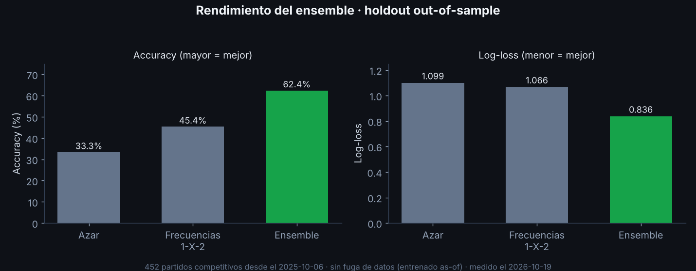
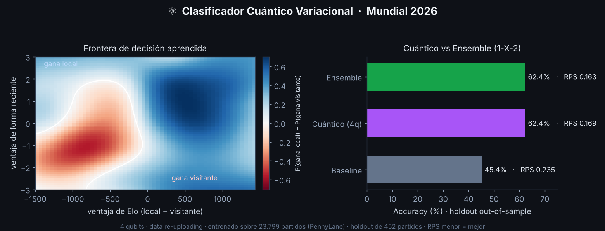
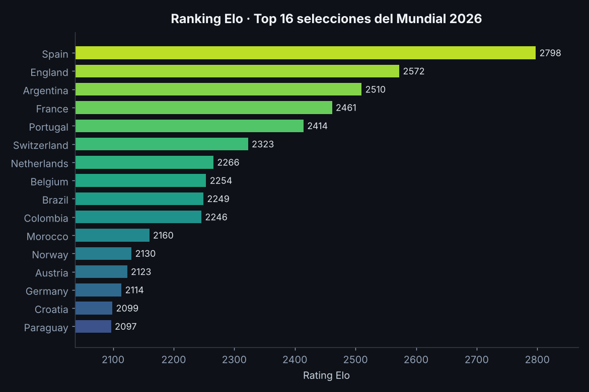
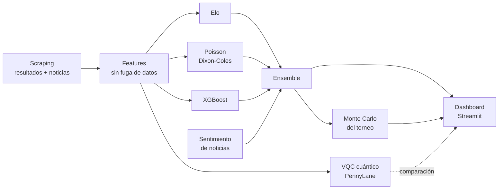

<div align="center">

# ⚽ Modelo Predictivo Mundial 2026

**Ensemble Elo + Poisson + XGBoost para predecir partidos del Mundial, comparado contra un clasificador cuántico de 4 qubits.**

[](https://github.com/AgustinBouzonn/modelo-predict-wc26/actions/workflows/ci.yml)
[](https://codecov.io/gh/AgustinBouzonn/modelo-predict-wc26)


[](LICENSE)

[**Demo en vivo**](https://agustinbouzonn.github.io/modelo-predict-wc26/) · [Inicio rápido](#-inicio-rápido) · [Cómo funciona](#-cómo-funciona) · [Módulo cuántico](README_QUANTUM.md)

</div>

---

Modelo **ensemble** que predice los partidos del Mundial 2026 (48 selecciones, 12 grupos) y se reentrena con nuevos resultados, datasets y noticias. Incluye un dashboard interactivo en Streamlit, simulación Monte Carlo del torneo y un módulo experimental de **Machine Learning cuántico** evaluado contra los modelos clásicos con las mismas métricas.

> 🔮 **[Probá el predictor cuántico en el navegador →](https://agustinbouzonn.github.io/modelo-predict-wc26/)**
> Elegí dos selecciones y "medí el qubit". Corre en el navegador, sin instalar nada.

## 📊 Resultados

Medido el **2026-10-19** con la configuración actual del ensemble (Elo 0.2 · Poisson 0.8 · XGBoost 0, en `config/teams_wc26.yaml`) y datos hasta el 2026-10-06.

**Mundial 2026 · 104 partidos.** El ensemble se entrena solo con partidos anteriores al 11 de junio de 2026.

| Modelo | Accuracy | Log-loss | RPS |
|--------|:--------:|:--------:|:---:|
| 🧮 **Ensemble** (Elo · Poisson) | **68.3%** | **0.838** | **0.156** |
| 📏 Baseline "siempre local" | 47.1% | 1.126 | 0.249 |

> [!NOTE]
> Los pesos y la calibración actuales se ajustaron en julio con un backtest que ya incluía partidos jugados de este Mundial. El modelo no vio esos resultados al entrenar, pero la elección de pesos sí, así que esta cifra no es del todo independiente.

**Holdout de 12 meses · 452 partidos competitivos**, del 2025-10-06 al inicio del Mundial.

| Modelo | Accuracy | Log-loss | RPS |
|--------|:--------:|:--------:|:---:|
| 🧮 **Ensemble** (Elo · Poisson) | **62.4%** | **0.836** | **0.163** |
| ⚛️ Cuántico (4 qubits, 1-X-2) | 62.4% | 0.874 | 0.169 |
| 📏 Baseline (frecuencias 1-X-2) | 45.4% | 1.066 | 0.235 |

Las métricas se calculan **sin fuga de datos**: cada modelo se entrena *as-of* una fecha de corte y se evalúa sobre lo posterior. El backtest evalúa el modelo base, sin el ajuste por sentimiento de noticias. RPS es el *Ranked Probability Score*, la métrica estándar para 1-X-2 (menor es mejor). Los dos modelos superan con claridad al baseline. El cuántico empata en accuracy, pero el ensemble asigna mejores probabilidades.

Para reproducirlas: `python -m src.pipeline`, después `python -m src.evaluation.backtest` y `python quantum_eval.py`. Las cifras de junio (63.7% y 64.1% sobre 601 partidos) usaban datos hasta el 18 de junio y otros pesos; quedan como registro histórico en [REPORTE_MEJORAS.md](REPORTE_MEJORAS.md).

<p align="center">
  
</p>

<p align="center">
  
</p>

Las figuras de rendimiento usan las métricas del holdout que guarda `quantum_eval.py` en [`docs/metricas_holdout.json`](docs/metricas_holdout.json). El reporte de la evaluación de junio, con el análisis de errores y las mejoras probadas, está en [REPORTE_MEJORAS.md](REPORTE_MEJORAS.md).

## ✨ Características

- 🧮 **Ensemble clásico** Elo + Poisson (Dixon-Coles) + XGBoost, con pesos optimizados por backtest. Hoy XGBoost tiene peso 0.
- 🗞️ **Sentimiento de noticias** (RSS de Google News + VADER) como ajuste del "momentum mediático" de cada selección.
- ⚛️ **Clasificador cuántico variacional** con PennyLane: 4 qubits y *data re-uploading*, comparado partido a partido contra el ensemble.
- 🎲 **Simulación Monte Carlo** del torneo completo: fase de grupos y llaves.
- 💹 **Benchmark contra el mercado de apuestas** (opcional, requiere API key de cuotas).
- 🖥️ **Dashboard Streamlit** con 10 pestañas, alineaciones en cancha (SVG) y proyección del cuadro eliminatorio.
- 🐳 **Docker y Streamlit Cloud**: la app entrena los modelos sola en el primer arranque.

## 🚀 Inicio rápido

```bash
git clone https://github.com/AgustinBouzonn/modelo-predict-wc26.git
cd modelo-predict-wc26
python -m venv .venv
source .venv/bin/activate           # Windows: .\.venv\Scripts\Activate.ps1
pip install -r requirements.txt

python -m src.pipeline              # descarga datos y entrena el ensemble
streamlit run app/dashboard.py      # abre el dashboard
```

O con **Docker**, que entrena los modelos en el primer arranque:

```bash
docker build -t wc26 .
docker run -p 8501:8501 wc26        # http://localhost:8501
```

Para publicarlo gratis en Streamlit Community Cloud, seguí los pasos de [DEPLOY.md](DEPLOY.md).

## 🖥️ Dashboard

`streamlit run app/dashboard.py` abre un panel con 10 pestañas:

`⚛️ Cuántico` · `🗓️ Fixture` · `🗺️ Torneo` · `🏆 Llaves` · `👥 Selecciones` · `⚽ Partido` · `📊 Ranking` · `🎲 Simular` · `📈 Rendimiento` · `🗞️ Datos`

Incluye predicción por partido con alineaciones en cancha, proyección del cuadro eliminatorio, simulación Monte Carlo del torneo y un benchmark medible contra el mercado de apuestas. El botón **🔄 Recargar datos** de la pestaña Datos toma los modelos reentrenados sin reiniciar el proceso.

<p align="center">
  
</p>

## 🧠 Cómo funciona

| Modelo | Qué aporta |
|--------|-----------|
| **Elo** | Fuerza relativa de cada selección, actualizable partido a partido |
| **Poisson (Dixon-Coles)** | Goles esperados, marcador más probable y probabilidad de cada resultado |
| **XGBoost** | Patrones no lineales sobre Elo, forma reciente y descanso |
| **VQC cuántico** | Clasificador 1-X-2 de 4 qubits, evaluado aparte como comparación |

Los pesos del ensemble viven en `config/teams_wc26.yaml` y se eligen por backtest. Con la configuración actual el ensemble combina **Elo (0.2) y Poisson (0.8)**: XGBoost se entrena y se evalúa, pero la búsqueda de pesos le asigna 0 porque no mejora el log-loss.



## ▶️ Uso

**Entrenar**

```bash
python -m src.pipeline              # ensemble clásico (Elo, Poisson, XGBoost)
python quantum_match.py             # clasificador cuántico
```

Opciones del pipeline: `--no-fetch` no vuelve a descargar datos, `--no-news` saltea las noticias y `--sims 5000` simula el torneo al final.

**Evaluar out-of-sample**

```bash
python -m src.evaluation.backtest                    # backtest del ensemble
python -m src.evaluation.backtest --optimize-weights # búsqueda de pesos
python quantum_eval.py                               # cuántico vs ensemble
```

**Experimentos**

| Script | Qué hace |
|--------|----------|
| `quantum_ensemble.py` | Mezcla el cuántico con el ensemble y mide si aporta señal complementaria |
| `calibration_experiment.py` | Prueba *temperature scaling* sobre las probabilidades del ensemble |
| `quantum_hardware.py` | Corre el clasificador en Qiskit, en simulador o en una QPU real de IBM Quantum |
| `build_quantum_widget.py` | Genera el demo interactivo del predictor cuántico |
| `scripts/make_readme_figure.py` | Regenera las figuras de `docs/` a partir de `docs/metricas_holdout.json`; corré antes `quantum_eval.py`. Necesita matplotlib, que viene en `requirements-dev.txt` |

`quantum_hardware.py` necesita las dependencias opcionales de Qiskit, que no se instalan con `requirements.txt`:

```bash
pip install -r requirements-qiskit.txt
python quantum_hardware.py              # simulador local de Qiskit, sin token
python quantum_hardware.py --hardware   # QPU real de IBM Quantum (token en IBM_QUANTUM_TOKEN)
```

## 🔄 Datos y actualización

- **Histórico:** se descarga del dataset público de partidos internacionales. Volvé a correr `python -m src.pipeline` para reentrenar con lo último.
- **Resultados del Mundial:** `python -m src.data.live_results` los trae de the-odds-api y los vuelca a `data/raw/wc26_manual.csv`. También podés agregar filas a mano con `date,home_team,away_team,home_score,away_score`.
- **Grupos:** `config/teams_wc26.yaml` se regenera desde el fixture oficial con `python -m src.data.sources --regen-groups`.
- **Noticias:** `python -m src.data.news` refresca el sentimiento por selección.

Los modelos y los datos pesados no se versionan y se generan corriendo el pipeline. La API key de cuotas se lee de la variable de entorno `ODDS_API_KEY` o de `config/odds_api_key.txt`, que está en `.gitignore`. Sin ella, el benchmark de mercado y los resultados en vivo quedan desactivados.

**Actualización diaria en Windows.** `scripts/daily_update.ps1` guarda un snapshot de predicciones y reentrena. Programalo con el Task Scheduler:

```powershell
schtasks /create /tn "WC26 Update" /sc daily /st 09:00 ^
  /tr "powershell -ExecutionPolicy Bypass -File `"%CD%\scripts\daily_update.ps1`""
```

El log queda en `data/update.log`.

## 🧪 Desarrollo

```bash
pip install -r requirements-dev.txt
ruff check src app tests     # lint
pytest                       # tests de modelos, simulación, config y cuántico
```

El CI corre `ruff` y `pytest` con cobertura en cada push y PR sobre Python 3.13, y sube el reporte a Codecov. Los tests usan datos sintéticos, así que corren sin red ni descargas.

## 🗂️ Estructura del proyecto

```
config/teams_wc26.yaml        Grupos del torneo, alias y pesos del ensemble
src/
  config.py                   Rutas y carga de configuración
  data/sources.py             Ingesta del histórico y del fixture
  data/live_results.py        Resultados del Mundial en vivo
  data/news.py                Noticias y sentimiento por selección
  features/build_features.py  Features sin fuga de datos (Elo pre-partido, forma)
  models/elo.py               Modelo Elo
  models/poisson.py           Dixon-Coles (PoissonRegressor de sklearn + ρ)
  models/ml_model.py          Clasificador XGBoost local/empate/visitante
  models/quantum.py           Clasificador cuántico variacional (PennyLane)
  models/ensemble.py          Combina los modelos y aplica el ajuste por noticias
  simulation/tournament.py    Monte Carlo del torneo (grupos + llaves)
  evaluation/backtest.py      Backtest out-of-sample y optimización de pesos
  evaluation/odds_benchmark.py Benchmark contra el mercado de apuestas
  pipeline.py                 Orquesta ingesta, entrenamiento y ensemble
app/dashboard.py              Dashboard Streamlit
docs/                         Demo de GitHub Pages y figuras del README
tests/                        Tests con datos sintéticos
```

## 📚 Documentación

- [README_QUANTUM.md](README_QUANTUM.md): el módulo cuántico paso a paso.
- [REPORTE_MEJORAS.md](REPORTE_MEJORAS.md): reporte de evaluación y mejoras.
- [DEPLOY.md](DEPLOY.md): publicación en Streamlit Community Cloud.
- [CHANGELOG.md](CHANGELOG.md): hitos del proyecto.

## 🛠️ Stack

Python · pandas · NumPy · scikit-learn · XGBoost · PennyLane · Streamlit · Plotly · pytest · ruff

## 📄 Licencia

Distribuido bajo la licencia [MIT](LICENSE).
